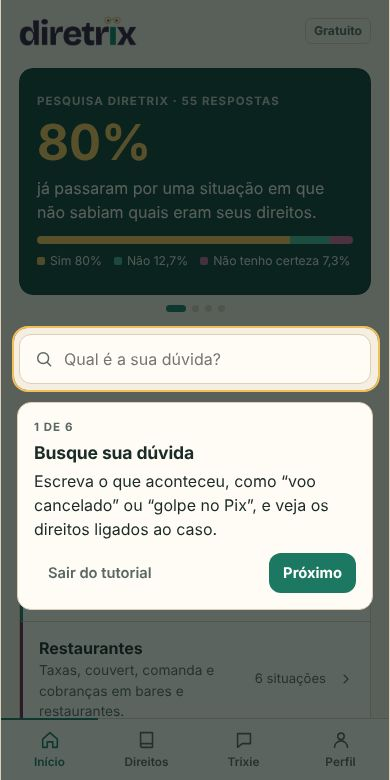
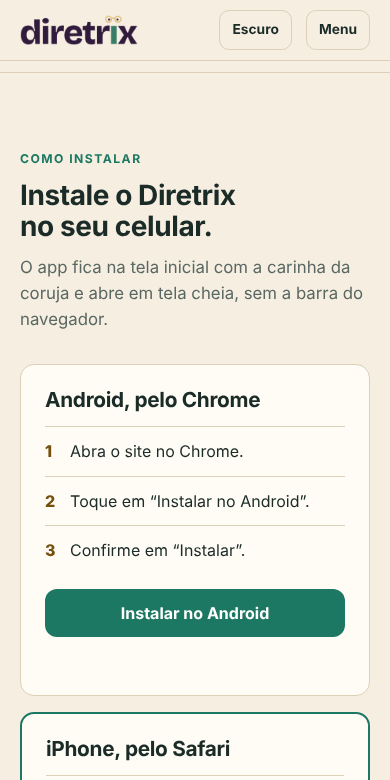

<p align="center">
  
</p>

<p align="center">
  <b>Seus direitos de consumidor, sem complicação.</b><br>
  Consultar → Entender → Agir
</p>

<p align="center">
  <a href="https://sabrinnalouise.github.io/Diretrix/"><b>Abrir o site</b></a> ·
  <a href="#como-instalar"><b>Como instalar</b></a>
</p>

---

## O que é

O **Diretrix** é um app de educação sobre direitos do consumidor no Brasil. Ele explica a lei em linguagem simples, mostra a fonte oficial de cada regra e indica o que fazer quando algo dá errado.

Quem acompanha você é a **Trixie**, uma coruja assistente que faz perguntas curtas para entender o seu caso e leva você direto ao próximo passo.

> O Diretrix oferece informação educativa e não substitui a orientação de um advogado.

## Por que existe

Em uma pesquisa feita pela equipe do Diretrix, com 55 respostas:

| Já passou por uma situação em que não sabia quais eram seus direitos? | |
| --- | --- |
| Sim | **80%** |
| Não | 12,7% |
| Não tenho certeza | 7,3% |

E reclamar funciona: em 2025 o Consumidor.gov.br finalizou **2.328.863** reclamações, com **81,43%** resolvidas pelas empresas e resposta média em **6 dias** ([Boletim Consumidor.gov.br 2025, Senacon/MJSP](https://www.gov.br/mj/pt-br/assuntos/seus-direitos/consumidor/defesadoconsumidor/Biblioteca/boletins-1/boletim-consumidor-gov-br-2025-vfinal.pdf)).

## O que o app faz

<p align="center">
  
  &nbsp;
  
</p>

| Recurso | Como funciona |
| --- | --- |
| **Biblioteca de direitos** | 30 situações em 5 categorias, sem cadastro. |
| **Lei em linguagem simples** | Cada artigo abre um painel com explicação, link oficial e data de revisão. |
| **Trixie** | Assistente guiada; cada conversa ganha um tema automático e fica no painel de conversas, à direita. Aceita fotos e documentos. |
| **Meu próximo passo** | Checklist, canais oficiais e uma mensagem pronta para enviar à empresa. |
| **Primeira vez** | Abertura animada com a logo e um tutorial que mostra onde fica cada coisa (dá para sair a qualquer momento). |
| **Planos** | Gratuito e Premium, com limites diferentes de envio (sem cobrança no protótipo). |
| **Acessibilidade** | Modo claro e escuro, tamanho de fonte, contraste e menos animações. |

### Categorias

| | Categoria | Exemplos |
| --- | --- | --- |
| 01 | **Aeroportos** | Atraso e cancelamento de voo, bagagem, embarque negado, reembolso |
| 02 | **Restaurantes** | Taxa de serviço, couvert, consumação mínima, perda de comanda |
| 03 | **Compras on-line e presenciais** | Arrependimento, troca, defeito, atraso na entrega |
| 04 | **Bancos e cartões** | Tarifas, golpe no Pix, compra não reconhecida, nome negativado |
| 05 | **Telefonia e internet** | Cancelamento, fatura indevida, fidelidade, internet lenta |

## Como instalar

O Diretrix é um app web instalável (PWA): não precisa de loja de aplicativos. O acesso ao protótipo é pelo app instalado, que abre em janela própria com este ícone:

<p align="center"></p>

| Aparelho | Navegador | Passos |
| --- | --- | --- |
| **Android** | Chrome | Abra o site e toque em **Instalar no Android**. Se já estiver instalado, o botão vira **Abrir o app**. |
| **iPhone** | Safari | Toque em **Compartilhar** (no iOS 26, em **•••** e depois **Compartilhar**), depois em **Adicionar à Tela de Início**, e deixe ligada a opção **Abrir como app web**. |

Quando o Diretrix é aberto pelo ícone da tela inicial, ele entra direto no app.

<p align="center">
  
</p>

## Estrutura do projeto

```
.
├── index.html              site de apresentação e instalação
├── app/                    o aplicativo (protótipo)
│   ├── index.html
│   └── js/
│       ├── base-juridica.js    direitos, leis, fontes e planos (fonte única de dados)
│       ├── trixie.js           assistente guiada, histórico e anexos
│       ├── ia-adapter.js       ponto de integração futura com IA
│       └── app.js              telas e navegação
├── img/                    imagens e animações da Trixie, logo
├── icons/                  ícones do app instalável
├── js/motion.js            biblioteca Motion (animação ligada à rolagem)
├── manifest.webmanifest    dados do app instalável
└── sw.js                   funcionamento offline
```

Não há etapa de build: são arquivos estáticos.

## Rodar no computador

```bash
git clone https://github.com/SabrinnaLouise/Diretrix.git
cd Diretrix
python3 -m http.server 8000
```

Abra <http://localhost:8000>. O protótipo fica em <http://localhost:8000/app/>.

## Fontes jurídicas

- [Código de Defesa do Consumidor (Lei nº 8.078/1990)](https://www.planalto.gov.br/ccivil_03/leis/l8078compilado.htm)
- [Decreto nº 7.962/2013 (comércio eletrônico)](https://www.planalto.gov.br/ccivil_03/_ato2011-2014/2013/decreto/d7962.htm)
- [ANAC: direitos dos passageiros](https://www.gov.br/anac/pt-br/assuntos/passageiros)
- [Consumidor.gov.br](https://www.consumidor.gov.br/)
- [Resolução CMN nº 3.919/2010 (tarifas bancárias)](https://normativos.bcb.gov.br/Lists/Normativos/Attachments/49514/Res_3919_v7_P.pdf)
- [Banco Central: Pix](https://www.bcb.gov.br/estabilidadefinanceira/pix)
- [Súmulas do STJ](https://scon.stj.jus.br/SCON/sumstj/)
- [Anatel: consumidor](https://www.gov.br/anatel/pt-br/consumidor)

Cada conteúdo do app mostra se está **verificado**, **pendente de revisão** ou **desatualizado**.

## Situação atual

**Pronto no protótipo**
- Biblioteca, explicações, fontes e fluxo completo do direito de arrependimento
- Trixie guiada com histórico, fotos e documentos
- Meu próximo passo, checklist e gerador de mensagem
- Planos Gratuito e Premium (simulação, sem pagamento)
- Site com instalação para Android e iPhone

**Próximos passos**
- Conectar uma IA para perguntas livres e leitura de documentos
- Revisão jurídica profissional de todo o conteúdo
- Pagamentos reais do Premium
- Termos de uso e política de privacidade definitivos

## Privacidade

Nesta versão nada sai do aparelho: não há servidor, cadastro, CPF nem localização. Conversas e preferências ficam guardadas no navegador e podem ser apagadas no Perfil.

## Equipe

Feito por **Sabrinna Louise** e **Isabelle**.
